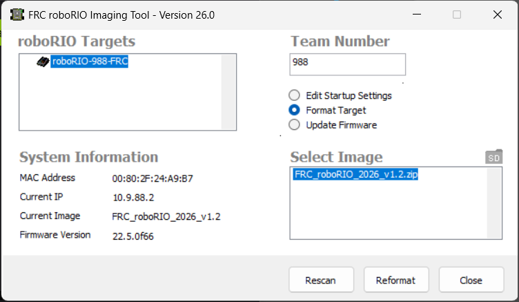

## RoboRio
Check the RoboRio is up-to date with  
FRC roboRIO Imaging Tool 



# Setup
## Python install
Python version must be 3.10 - 3.14
Check if python has been installed
```
py -3
```
Output should look like the following:
```
C:\Users\...>py -3
Python 3.14.7 (tags/v3.14.7:823f032, Aug  5 2026, 10:51:32) [MSC v.1944 64 bit (AMD64)] on win32
Type "help", "copyright", "credits" or "license" for more information.
>>>
```
If not install from:  
https://www.python.org/downloads/windows/


## Robopy install  
(https://docs.wpilib.org/en/stable/docs/zero-to-robot/step-2/python-setup.html)
```
py -3 -m pip install robotpy
```

### Starting a new project
In the folder run:
```
py -3 -m robotpy init
```
Which will create `robot.py` and `pyproject.toml`.

Then, run
```
py -3 -m robotpy sync
```
Which will: 
- Install Python into the RoboRIO
- Install modules listed in `pyproject.toml` under `requires=[]` into the RoboRIO
- Install modules listed in `pyproject.toml` under `requires=[]` into the local environment

### Team Number
[!IMPORTANT]


Create a folder `\.wpilib`
Create a json file `wpilib_preferences.json`
Edit the json to include:
```json
{"teamNumber": 988}
```